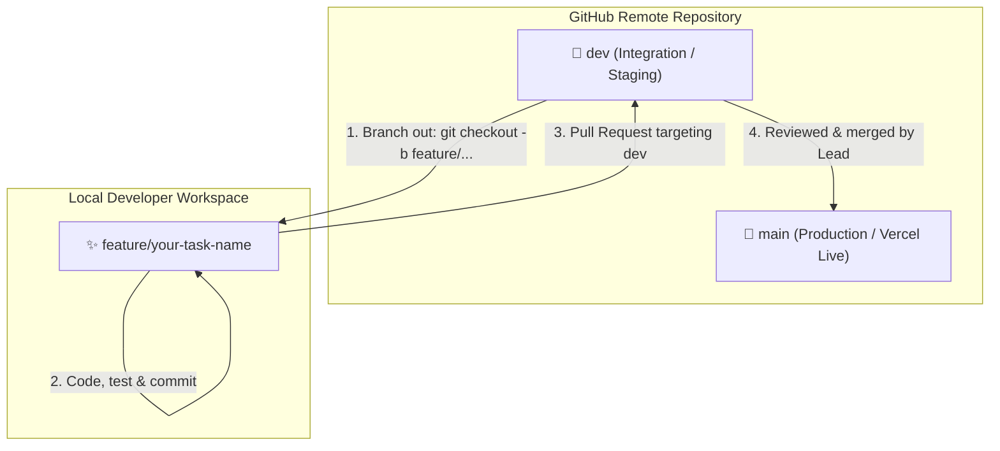

<div align="center">

  <a href="https://sajiyassparkle.vercel.app/" target="_blank" rel="noopener noreferrer">
    <picture>
      <source media="(prefers-color-scheme: dark)" srcset="frontend/assets/logo-astral-sparkle-dark.svg">
      <source media="(prefers-color-scheme: light)" srcset="frontend/assets/logo-astral-sparkle.svg">
      
    </picture>
  </a>

  <br />

  <p align="center">
    <strong>✨ Exquisite Handcrafted Jewellery • Curated Elegance • Modern E-Commerce ✨</strong>
  </p>

  <p align="center">
    A high-performance, full-stack jewellery e-commerce platform built for speed, security, and refined luxury.<br />
    Powered by <strong>Vanilla ES Modules</strong>, <strong>Vite</strong>, <strong>Supabase BaaS (PostgreSQL + Auth + Storage)</strong>, and deployed seamlessly on <strong>Vercel</strong>.
  </p>

  <p align="center">
    <a href="https://sajiyassparkle.vercel.app/"><strong>Explore Live Storefront »</strong></a>
    <br /><br />
    <a href="#-key-features">Key Features</a> •
    <a href="#-tech-stack">Tech Stack</a> •
    <a href="#-getting-started">Quick Start</a> •
    <a href="#-admin-management-suite">Admin Suite</a> •
    <a href="#-database--backend-architecture">Database</a> •
    <a href="#-testing--quality-assurance">Testing</a> •
    <a href="#-team-git-workflow">Git Workflow</a>
  </p>

  <p align="center">
    <a href="https://sajiyassparkle.vercel.app/"></a>
    <a href="https://vitejs.dev/"></a>
    <a href="https://supabase.com/"></a>
    <a href="https://developer.mozilla.org/en-US/docs/Web/JavaScript"></a>
    <a href="#-testing--quality-assurance"></a>
    <a href="#-license"></a>
  </p>

</div>

---

## 📖 Table of Contents

- [Overview](#-overview)
- [Key Features](#-key-features)
  - [Customer Storefront](#-customer-storefront)
  - [Admin Management Suite](#-admin-management-suite)
  - [Security & Session Isolation](#-security--session-isolation)
- [Tech Stack](#-tech-stack)
- [Project Architecture & Directory Structure](#-project-architecture--directory-structure)
- [Getting Started](#-getting-started)
  - [Prerequisites](#prerequisites)
  - [Installation](#installation)
  - [Environment Configuration](#environment-configuration)
  - [Running the Development Server](#running-the-development-server)
  - [Building for Production](#building-for-production)
- [Database & Backend Architecture](#-database--backend-architecture)
  - [Schema Overview](#schema-overview)
  - [Row Level Security (RLS)](#row-level-security-rls)
  - [Stored Procedures & Database Triggers](#stored-procedures--database-triggers)
- [Testing & Quality Assurance](#-testing--quality-assurance)
- [Team Git Workflow & Collaboration](#-team-git-workflow)
  - [Branch Structure](#branch-structure)
  - [Golden Rules](#golden-rules)
  - [Step-by-Step Contribution Guide](#step-by-step-contribution-guide)
  - [Git Quick Command Reference](#git-quick-command-reference)
- [Deployment](#-deployment)
- [Contributing](#-contributing)
- [License](#-license)

---

## 🌟 Overview

**Sajiya's Sparkle** is an artisanal, luxury e-commerce platform curated for fine jewellery lovers in Dhaka, Bangladesh, with nationwide fulfillment. Built from the ground up without heavy frontend framework overhead, the application delivers lightning-fast load times, fluid transitions, and a clean minimalist aesthetic inspired by classic haute joaillerie.

Under the hood, **Vite** powers rapid bundling and hot module replacement, while **Supabase** delivers enterprise-grade PostgreSQL persistence, authentication, role-based access control, file storage for high-resolution product imagery, and automated business rule enforcement via SQL triggers.

---

## ✨ Key Features

### 🛍️ Customer Storefront

- **Editorial Hero & Dynamic Catalog**: High-resolution jewellery highlights, curated featured collections, and interactive product grids.
- **Instant Search & Multi-Faceted Filters**: Real-time filtering by category (Earrings, Necklaces, Bracelets, Rings, Jewellery Sets), price ranges, and keyword search.
- **Cart & Dynamic Pricing**: Persistent shopping cart with instantaneous quantity adjustments, automated subtotal calculations, and regional delivery rates (Inside Dhaka: ৳60, Outside Dhaka: ৳120).
- **Interactive Wishlist**: Personal collection of saved favorites with database-level quota enforcement (up to 5 items).
- **Complete Checkout & Invoice Pipeline**: Seamless order submission, customer address capture, order summary generation, and instant printable/savable confirmation receipts.
- **Customer Account Portal**: Secure user authentication, profile details management, and comprehensive order history tracking.
- **Direct Inquiry Messaging**: Dedicated contact portal connecting shoppers directly with customer support.

### 🛡️ Admin Management Suite

- **Comprehensive Analytics Dashboard**: Live metrics for revenue, total orders, pending shipments, inventory health, and registered customer tallies.
- **Product Catalog Management**: Complete CRUD interface for jewellery items (name, category, price, discount price, stock status, description, and direct image upload to Supabase Storage).
- **Order Processing & Lifecycle Control**: Full pipeline tracking with real-time status updates (`Pending` ➔ `Processing` ➔ `Shipped` ➔ `Delivered` ➔ `Cancelled`).
- **Customer Relationship Manager**: Directory of registered patrons with contact info and purchase volume analytics.
- **Support Inbox**: Unified dashboard for reading, triaging, and responding to customer contact requests.
- **Role-Based Access Control (RBAC)**: Super Admin privileges with administrative quota enforcement via PostgreSQL stored procedures.

### 🔒 Security & Session Isolation

- **Tab-Isolated Session Architecture**: Custom authentication state management prevents mutual logouts across concurrent browser tabs.
- **Protected Administrative Endpoints**: Client-side auth-bootstrap checks paired with PostgreSQL Row Level Security (RLS) enforce airtight role separation.
- **Sanitized Data Ingestion**: Clean payload validation across all forms and API transactions.

---

## 🛠 Tech Stack

| Category | Technology | Description |
| :--- | :--- | :--- |
| **Frontend Framework** | **Vanilla ES Modules** | Lightweight, modular JavaScript (zero bulky runtime overhead) |
| **Styling & Design** | **CSS3 + Design Tokens** | Custom responsive grid/flexbox layouts, elegant typography, fluid animations |
| **Build Tool & Bundler** | [Vite 7](https://vitejs.dev/) | Multi-page configuration, ultra-fast HMR, optimized production rollups |
| **Backend as a Service** | [Supabase](https://supabase.com/) | Managed PostgreSQL 15, Supabase Auth, Storage Buckets, Row Level Security |
| **Testing Suite** | [Jest 29](https://jestjs.io/) + [JSDOM](https://github.com/jsdom/jsdom) | Automated unit testing for auth state, storage mocks, and session isolation |
| **Transpilation** | [Babel](https://babeljs.io/) | `@babel/preset-env` and `babel-jest` for seamless modern JS testing |
| **Cloud Hosting** | [Vercel](https://vercel.com/) | Edge-optimized serverless static deployment with global CDN |

---

## 📂 Project Architecture & Directory Structure

```text
sajiyassparkle/
├── frontend/                     # Core application source
│   ├── assets/                   # Brand assets, logos, and photography
│   │   ├── favicon.svg           # Site favicon
│   │   ├── logo-astral-sparkle.svg       # Light-theme brand vector logo
│   │   ├── logo-astral-sparkle-dark.svg  # Dark-theme brand vector logo
│   │   └── hero-image.jpg        # Hero banner imagery
│   ├── css/                      # Modular style sheets
│   │   ├── base.css              # Reset, typography, and CSS variables
│   │   ├── components.css        # Reusable buttons, cards, modals, inputs
│   │   └── index.css             # Page-specific layout styles
│   ├── js/                       # ES modules & application logic
│   │   ├── __tests__/            # Jest unit test suites
│   │   │   ├── auth-state.test.js
│   │   │   └── auth-state-multi-tab.test.js
│   │   ├── admin-*.js            # Admin dashboard, orders, products, customers
│   │   ├── auth-state.js         # Session cache & tab isolation controller
│   │   ├── cart-nav.js           # Live cart badge synchronization
│   │   ├── checkout.js           # Order calculation & placement logic
│   │   ├── collections.js        # Catalog search, filter, and rendering
│   │   ├── index.js              # Home page animations and spotlight feeds
│   │   └── supabase.js           # Supabase client singleton initialization
│   ├── pages/                    # Multi-page HTML templates
│   │   ├── about.html            # Brand story & craftsmanship
│   │   ├── admin-*.html          # Protected administrative management views
│   │   ├── checkout.html         # Cart, shipping details, and payment
│   │   ├── collections.html      # Product gallery & filterable catalogue
│   │   ├── contact.html          # Customer support inquiry form
│   │   ├── order-confirmation.html # Receipt generation and invoice review
│   │   ├── profile.html          # User account & address management
│   │   ├── user-login.html       # Authentication (Sign in, Sign up, Recovery)
│   │   └── wishlist.html         # Saved items portal
│   └── index.html                # Application root entry point
├── .env.example                  # Environment variables template
├── babel.config.js               # Babel preset configuration for Jest
├── jest.config.js                # Jest environment and coverage settings
├── jest.setup.js                 # Global test environment polyfills & mocks
├── package.json                  # NPM dependencies and workflow scripts
├── supabase_schema.sql           # Complete PostgreSQL DDL, triggers, and RLS policies
├── UNIT_TEST_REPORT.md           # Formal unit test report and verification logs
├── vercel.json                   # Vercel deployment and routing configuration
└── vite.config.js                # Multi-page build configuration
```

---

## 🚀 Getting Started

Follow the steps below to run a local instance of Sajiya's Sparkle.

### Prerequisites

Ensure you have the following installed on your machine:
- [Node.js](https://nodejs.org/) (version **18.x** or higher recommended)
- [Git](https://git-scm.com/)
- A [Supabase](https://supabase.com/) account (or credentials from the project lead)

### Installation

1. **Clone the repository:**
   ```bash
   git clone https://github.com/sheikhhossainn/sajiyassparkle.git
   cd sajiyassparkle
   ```

2. **Install project dependencies:**
   ```bash
   npm install
   ```

### Environment Configuration

Create a local `.env` file in the root directory:

```bash
cp .env.example .env
```

Open `.env` and provide your Supabase project credentials:

```env
VITE_SUPABASE_URL=https://your-project-id.supabase.co
VITE_SUPABASE_ANON_KEY=your-anon-key-here
```

| Variable | Description |
| :--- | :--- |
| `VITE_SUPABASE_URL` | The REST/GraphQL API endpoint of your Supabase instance. |
| `VITE_SUPABASE_ANON_KEY` | Public client anon key for Row Level Security requests. |

> [!NOTE]
> If you are a team member onboarding for the first time, request development keys from the team lead.

### Running the Development Server

Launch Vite's local development server:

```bash
npm run dev
```

The application will start at `http://localhost:3000` (or the next available port) with live hot module replacement.

### Building for Production

Compile and bundle the production assets into the `dist/` directory:

```bash
npm run build
```

Preview the production build locally:

```bash
npm run preview
```

---

## 🗄️ Database & Backend Architecture

The backend is powered by **Supabase PostgreSQL 15**, configured via [`supabase_schema.sql`](file:///d:/Coding/sajiyassparkle/supabase_schema.sql).

### Schema Overview

- `profiles`: User information, full name, phone number, address, `is_admin`, and `is_super_admin` flags.
- `products`: Complete inventory catalog with categories, pricing, stock levels, and asset URLs.
- `orders`: Transaction headers including customer UUID, delivery address, shipping cost, total amount, and status.
- `order_items`: Line-item breakdown linking orders to products with unit prices and quantities.
- `wishlist`: User-curated favorite jewellery items.
- `messages`: Customer inquiries submitted via the contact portal.
- `admin_activity_logs`: Audit trail for administrative actions.

### Row Level Security (RLS)

All tables have strict Row Level Security enabled:
- **Customers** can only read and mutate their own profile, orders, order items, and wishlist entries.
- **Public Users** can read active product listings.
- **Admins** have elevated privileges granted by `is_admin = true` profile validation.

### Stored Procedures & Database Triggers

- `check_wishlist_limit()`: A PostgreSQL `BEFORE INSERT` trigger enforcing a hard limit of **5 items** per customer wishlist.
- `add_admin(target_email)`: A `SECURITY DEFINER` function allowing only Super Admins to promote users, capped at a maximum quota of **2 additional admins**.
- `delete_user_account()`: Secure RPC allowing customers to cascade-delete their account and personal data cleanly.

---

## 🧪 Testing & Quality Assurance

Sajiya's Sparkle uses **Jest 29+** and **JSDOM** to ensure session integrity and prevent critical authentication regressions.

```bash
# Run the complete test suite
npm test

# Run tests in interactive watch mode
npm run test:watch

# Generate code coverage report
npm run test:coverage

# Run tests with verbose detailed output
npm run test:report
```

### Test Suite Highlights

Refer to [`UNIT_TEST_REPORT.md`](file:///d:/Coding/sajiyassparkle/UNIT_TEST_REPORT.md) for full execution logs:
- **Test Suites**: 2 passed, 2 total
- **Unit Tests**: 39 passed, 39 total (100% pass rate)
- **Key Coverage**:
  - `auth-state.test.js`: Session storage utilities, logout flags, session caching, and graceful error handling.
  - `auth-state-multi-tab.test.js`: Cross-tab synchronization and session isolation (preventing unwanted mutual logouts across concurrent tabs).

---

## 🤝 Team Git Workflow

To maintain clean repository hygiene and prevent deployment breaks, all contributors adhere to this workflow.

### Branch Structure



- **`main`** ➔ Production-ready, stable releases. Locked and deployed automatically via Vercel.
- **`dev`** ➔ Staging and active integration branch. All features merge here first.
- **`feature/<task-name>`** ➔ Isolated working branches for each bugfix or feature.

---

### ⚠️ Golden Rules

1. ❌ **Never commit or push directly to `main` or `dev`**.
2. ✅ **Always branch from the latest `dev`**.
3. ✅ **Write clear, atomic commit messages** (e.g., `feat(cart): calculate regional shipping rate`).
4. ✅ **Ensure tests pass (`npm test`) before opening a Pull Request**.
5. ✅ **All merges into `dev` require review and approval from the Team Lead**.

---

### Step-by-Step Contribution Guide

#### Step 1: Synchronize `dev`
```bash
git checkout dev
git pull origin dev
```

#### Step 2: Create a Feature Branch
```bash
git checkout -b feature/your-task-name
```
*Example: `git checkout -b feature/order-receipt-pdf`*

#### Step 3: Develop & Commit
```bash
git add .
git commit -m "feat(checkout): add order receipt breakdown"
```

#### Step 4: Keep Your Branch Synchronized
Before submitting, rebase or merge the latest `dev` into your feature branch to resolve any conflicts locally:
```bash
git checkout dev
git pull origin dev
git checkout feature/your-task-name
git merge dev
```

#### Step 5: Push and Open a Pull Request
```bash
git push -u origin feature/your-task-name
```
Navigate to GitHub, create a Pull Request targeting **`base: dev`**, fill out the description, and request a review from the team lead.

---

### Git Quick Command Reference

| Action | Command |
| :--- | :--- |
| **Pull latest development branch** | `git checkout dev && git pull origin dev` |
| **Create new feature branch** | `git checkout -b feature/task-name` |
| **Inspect modified files** | `git status` |
| **Stage all changes** | `git add .` |
| **Commit staged changes** | `git commit -m "type(scope): concise description"` |
| **Push feature branch to remote** | `git push -u origin feature/task-name` |
| **Merge latest dev into branch** | `git merge dev` |
| **Delete local branch after merge** | `git branch -d feature/task-name` |

---

## 🚢 Deployment

The project is hosted and continuously deployed via **Vercel**.

1. Every merge into **`dev`** creates an instant preview deployment.
2. Every merge into **`main`** triggers an automatic production release to:
   👉 **[https://sajiyassparkle.vercel.app/](https://sajiyassparkle.vercel.app/)**

### Vercel Configuration ([`vercel.json`](file:///d:/Coding/sajiyassparkle/vercel.json))

```json
{
  "$schema": "https://openapi.vercel.sh/vercel.json",
  "framework": "vite",
  "installCommand": "npm install",
  "buildCommand": "npm run build",
  "outputDirectory": "dist"
}
```

Ensure the production environment variables (`VITE_SUPABASE_URL` and `VITE_SUPABASE_ANON_KEY`) are set in your **Vercel Project Settings ➔ Environment Variables**.

---

## 📄 License

This project is licensed under the **ISC License**. See the repository details for full terms.

---

<div align="center">

  <p>Crafted with passion for <strong>Sajiya's Sparkle</strong> ✨</p>
  <p>
    <a href="https://sajiyassparkle.vercel.app/">Storefront</a> •
    <a href="https://sajiyassparkle.vercel.app/pages/collections.html">Collections</a> •
    <a href="https://sajiyassparkle.vercel.app/pages/about.html">About Us</a> •
    <a href="https://sajiyassparkle.vercel.app/pages/contact.html">Support</a>
  </p>

</div>